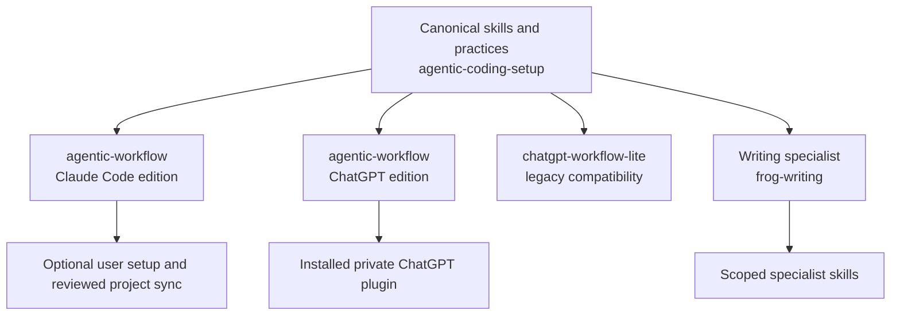
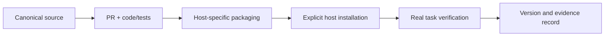

# Plugin product map

> Canonical map for the **public agentic-coding-setup plugin family**, source-reviewed on 2026-11-12. The owning code/manifests and observed host behavior take precedence. Product-specific private assistants and their proprietary files are deliberately out of scope.

## 1. Product landscape

**Map boundary:** These are package/source relationships, not automatic network connections or installs. Source merge, CI, package upload, host installation and real task proof are distinct events.

## 2. Packages and ownership

| Package | Purpose and ownership | Source | Host boundary |
| --- | --- | --- | --- |
| `agentic-workflow` (Claude Code edition) | 18 engineering, presentation, and design skills; optional Claude-specific agent, hooks and sync | `plugins/agent-workflow/` | Claude Code; installation and sync explicit |
| `agentic-workflow` (ChatGPT edition) | The same 18 canonical skills adapted for ChatGPT, plus four portable review skills | `portable/agentic-workflow/`; `scripts/package_agentic_workflow_chatgpt.py` | Private, skills-only ChatGPT edition; tools are host-provided |
| `chatgpt-workflow-lite` | Historical four-skill compatibility package, deprecated for new ChatGPT users | `portable/ogfrench-workflow/` | Legacy version frozen; no coordinated release claim |
| `frog-writing` | Distinctive writing and copy editing | `plugins/frog-writing/` | Specialist plugin with independent release |
| `21st` | Pinned external UI tooling | `.claude-plugin/marketplace.json` | External dependency with its own behavior and version |

For the coordinated workflow editions only, the release identifier is `YYYY.MM.N` (UTC year/month, monthly sequence starting at 1). This product map does not assert version equality for independent specialist or legacy products.

## 3. Skill routing and overlap

| User job | Primary owner | Optional complement | Avoid |
| --- | --- | --- | --- |
| Product features, installed surfaces and real journeys | `product-passport` | `implementation-proof` (ChatGPT), `session-continuity` | Treating docs as stronger than code |
| Architecture drift/root cause | `architecture-gardener` | `adversarial-review` (ChatGPT) | Using diagramming as an architecture audit |
| System map, architecture diagram, Mermaid or clean technical figure | `diagram-craft` | `visual-loop` for rendered QA | Image generation as an exact graph exporter |
| UI comparison or actual visual correctness | `visual-loop` | `diagram-craft` for relationship figures | Adding a second visual-QA process |
| PR delivery and verification | `delivery-loop` | `session-continuity`, `release-handover` (ChatGPT) | Independent invented agents/trackers |
| Plugin installation or cross-host release | `plugin-experience-design` | `setup-audit` (ChatGPT) | Assuming installed means connected |
| Research indexing or MCP/retrieval design | `knowledge-base-builder` | `best-practices` | Publishing product-private corpus |
| Issue triage and actionable backlog | `issue-management` | `delivery-loop` when explicitly executing | Doing issue mutation from an inspection |
| Learnings and existing practices | `learning-loop` / `best-practices` | `model-delegation` only when needed | Loading the entire knowledge base |
| Cost reduction | `actions-cost` / `netlify-cost` | `token-efficiency` | Optimizing away required verification |
| Communications, decks, brand writing | `presentation-story` / `presentation-design` / `frog-writing` | `diagram-craft` for diagram assets | Implying generic workflow owns specialist product content |

The three presentation and design skills are canonical in both full workflow editions. `visual-loop` also owns visual restraint. Named presentation products such as frogViz keep authority over actual generation and export. The remaining portable ChatGPT skills are `adversarial-review`, `implementation-proof`, `release-handover` and `setup-audit`. They are not part of the Claude workflow's canonical 18-skill set. `model-delegation` chooses how much agent/tool assistance is warranted, not a mandatory dispatcher.

## 4. Capability and release lifecycle

- `plugins/agent-workflow/skills/` is the **canonical shared source**. ChatGPT packaging copies approved Markdown and adds host capability guidance. No hooks, MCP servers or local executables are smuggled into that edition.
- Repo-level `setup-user.sh`, `sync-to-repos.sh`, `project/settings.json` and marketplace configuration are Claude-specific. They do not update an already installed ChatGPT plugin.
- The release number is synchronized across `plugins/agent-workflow/.claude-plugin/plugin.json` and `portable/agentic-workflow/plugin.json`. A build/test gate rejects drift; independent plugin families retain independent versions.
- An actual release requires separate GitHub source acceptance, artifact provenance, installed-host acceptance and rollback record. Skills grant no permissions, account data or background execution.

## 5. Maintenance

Refresh this map when packages, skill ownership, host support, source boundaries or release contracts change. Update the same PR as the code or manifest change. Verify each claimed path against the repo; review readme/install references for stale version strings. Use the Product Passport [feature contract](feature-contract.md) for detailed journey records where beneficial. Do not overmap every function or create a universal orchestration layer.
